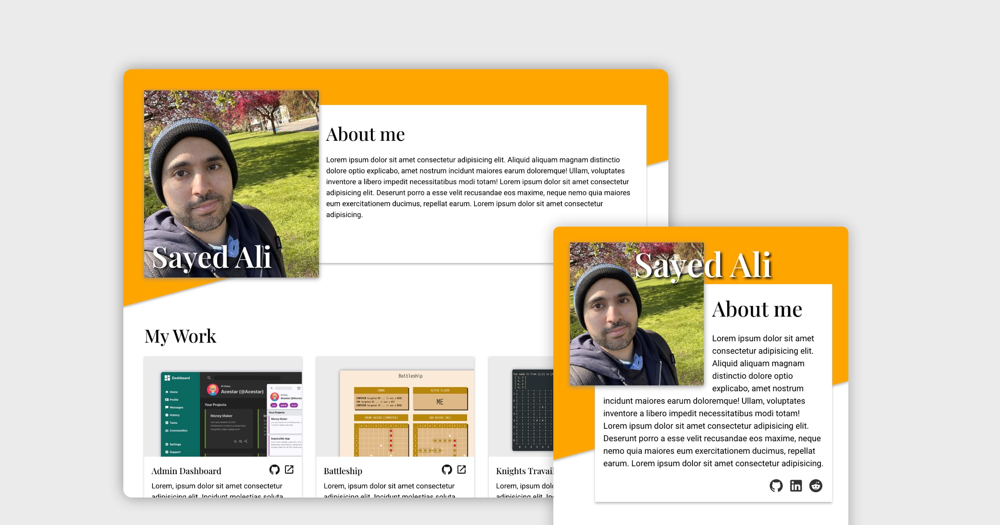

# The Odin Project - Homepage

A solution to the [Project: Homepage](https://www.theodinproject.com/lessons/node-path-advanced-html-and-css-homepage)'s challenge from The Odin Project.

[Source Code](https://github.com/sydalwedaie/odin-project-homepage) •
[Live Preview](https://odin-project-homepage-ri81j.netlify.app/)

## Project Description

This is the capstone project of the Advanced HTML/CSS course. The main focus is on responsive design (mobile to desktop), with some animated elements and emphasis on accessibility.
